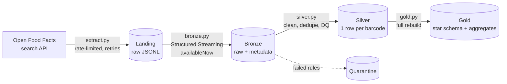

# Open Food Facts Lakehouse Pipeline


A batch data pipeline that loads food product data from the
[Open Food Facts API](https://world.openfoodfacts.org/) into a local **lakehouse** built with
**PySpark** and **Delta Lake**, following the **medallion architecture** (Bronze → Silver → Gold).

The project started as a pandas + SQLite notebook ([v1](#project-history)). Version 2 rebuilds it
as a tested Python package with incremental loads, data quality checks and an Airflow DAG.

---

## Architecture



| Layer | Table(s) | What happens | Write mode |
|-------|----------|--------------|------------|
| **Landing** | `landing/products/ingest_date=…/*.jsonl` | API pages saved unchanged | new files per run |
| **Bronze** | `bronze/products` | Raw records + `_ingested_at`, `_source_file` | append, only new files (streaming checkpoint) |
| **Silver** | `silver/products` | Typed nutrients, normalised tags, newest version per barcode, data quality rules | `MERGE` by barcode |
| | `silver/products_rejected` | Rows that failed a rule, with the rule names | overwrite |
| **Gold** | `dim_*`, `fact_product`, `bridge_product_country`, `agg_*` | Star schema and aggregates for analytics | overwrite |

## Key design points

- **Respects the API limits.** The search endpoint allows 10 requests/minute per IP. The extractor
  waits 6.5 s between pages, retries with exponential backoff on `429`/`5xx`, and sends a
  `User-Agent` with a contact address as Open Food Facts asks.
- **Incremental and idempotent.** Bronze uses Structured Streaming with `trigger(availableNow=True)`:
  the checkpoint tracks which landing files were ingested, so each run processes only new files.
  Silver uses a Delta `MERGE` on the barcode and only replaces a row with a newer version.
  Running the pipeline twice gives the same result.
- **Data quality is visible.** Invalid rows are not silently dropped: they go to a quarantine
  table with the names of the failed rules (missing nutrients, out-of-range values, non-food
  categories, missing barcode, …).
- **Testable transformations.** Each layer separates pure DataFrame transformations from reading
  and writing, so the logic is unit-tested on small fixture data without touching storage.
- **Explicit schema** for raw data instead of schema inference.

More details and the alternatives considered: [docs/decisions.md](docs/decisions.md).

## Gold data model

```
dim_brand (brand_key, brand_name)          dim_country (country_key, country_name)
        ▲                                            ▲
        │                                            │
fact_product ───────────────────────────── bridge_product_country
  product_code (PK)                          product_code, country_key
  product_name, brand_key, category_key
  sugar_100g, energy_100g_kj, protein_100g
  sugar_level, energy_level, protein_level, is_healthy
        │
        ▼
dim_category (category_key, category_name)
```

Surrogate keys are a hash of the natural key (`xxhash64`), so they stay stable when Gold is rebuilt.

| Feature | Rule (per 100 g) |
|---------|------------------|
| `sugar_level` | 0: < 10 g, 1: 10–20 g, 2: > 20 g |
| `energy_level` | 0: < 400 kJ, 1: 400–1600 kJ, 2: > 1600 kJ |
| `protein_level` | 0: < 5 g, 1: 5–15 g, 2: > 15 g |
| `is_healthy` | sugar < 10 g **and** protein > 5 g (a simple project heuristic, not a nutritional standard) |

## How to run

Requirements: Python 3.10+ and Java 17 or 21 (needed by Spark).

```bash
# macOS: brew install openjdk@17
git clone https://github.com/alels001/etl-data-pipeline.git
cd etl-data-pipeline
python -m venv .venv && source .venv/bin/activate
pip install -e ".[dev]"

export OFF_CONTACT_EMAIL="you@example.com"   # sent in the API User-Agent

make test      # unit tests + end-to-end Delta test on fixture data (no API calls)
make run       # download 20 pages (~2,000 products, ~2 min) and build all layers
make rebuild   # rebuild Silver and Gold from Bronze, no API calls
```

On the first run Spark downloads the Delta Lake jars from Maven (cached afterwards).
Run single steps with `python -m off_pipeline --steps bronze silver` or change the amount of
data with `--max-pages`. The lakehouse is written to `data/lakehouse/`
(override with `LAKEHOUSE_PATH`).

### Query the Gold layer

```python
from off_pipeline.spark import get_spark

spark = get_spark()
spark.read.format("delta").load("data/lakehouse/gold/agg_category_nutrition") \
    .orderBy("n_products", ascending=False).show(10, truncate=False)

# Delta keeps a version history of every table
spark.sql("DESCRIBE HISTORY delta.`data/lakehouse/silver/products`").show(truncate=False)
```

## Orchestration

[`orchestration/dags/off_pipeline_dag.py`](orchestration/dags/off_pipeline_dag.py) is an Airflow
DAG that runs `extract → bronze → silver → gold` daily, with retries and `max_active_runs=1`
so two runs never merge into Silver at the same time. Each task calls the same CLI that is used
locally, so Airflow only handles scheduling and dependencies. The DAG is checked to load in
Airflow 3.1; it is not deployed anywhere.

## Tests and CI

```
tests/
├── test_extract.py               API client with a fake session (no network)
├── test_silver.py                cleaning, dedupe, data quality rules
├── test_gold.py                  levels, healthy flag, bridge table, key integrity
├── test_cli.py                   package imports and CLI starts
└── test_pipeline_integration.py  full run with Delta: idempotency, MERGE update and insert
```

GitHub Actions runs `ruff` and the full test suite on every push.

## Project history

| Version | What it was |
|---------|-------------|
| **v1** — [`notebooks/01_prototype_pandas_sqlite.ipynb`](notebooks/01_prototype_pandas_sqlite.ipynb) | One notebook: API → JSON → CSV → pandas cleaning → normalised SQLite database |
| **v2** — this package | Medallion lakehouse with PySpark + Delta Lake, incremental loads, DQ quarantine, tests, CI, Airflow DAG |

Problems in v1 that v2 fixes:

- requests were sent with only a 0.2 s pause, far above the API's limit of 10 searches/minute,
  and without timeout or retry handling;
- no barcode was extracted, so duplicates could only be detected as fully identical rows;
- only the first country of a product was kept, so the many-to-many country table held one
  country per product, and countries were linked by product *name*, which mixes up products
  with the same name;
- the energy thresholds assumed kcal, but `energy_100g` is in kJ, so almost every product
  landed in the "high" group;
- the `baby` filter removed baby food, which is food;
- every run re-downloaded and reloaded everything; nothing was tested.

## Possible next steps

- Run on AWS: store the lakehouse on S3 and run Spark on EMR (needs the `hadoop-aws` connector).
- Package the pipeline as a Docker image and run it as a Spark job on Kubernetes.
- Build Gold incrementally from Silver with Delta Change Data Feed instead of a full rebuild.
- For a full-catalogue load, use the Open Food Facts bulk export instead of the API.

## Data source

[Open Food Facts](https://world.openfoodfacts.org/) — a free, collaborative database of food
products. Data is available under the
[Open Database License (ODbL)](https://opendatacommons.org/licenses/odbl/1-0/).

## Author

**Ali Elshafey** — M.Sc. Data Science student, FH Dortmund ·
[LinkedIn](https://www.linkedin.com/in/ali-elshafey-5360641b9) · [GitHub](https://github.com/alels001)
